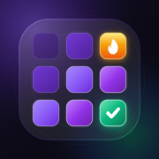
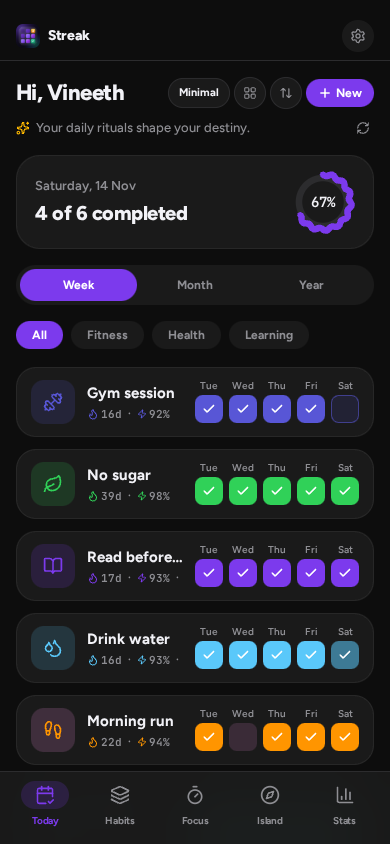
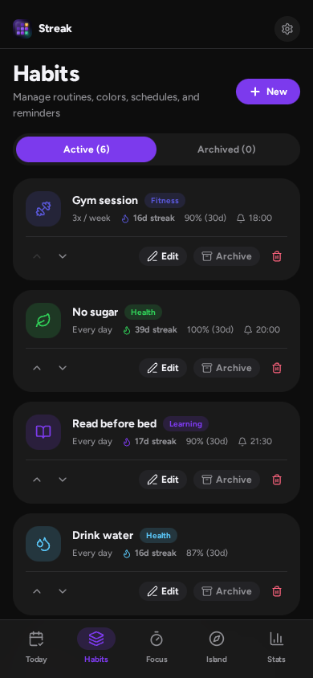
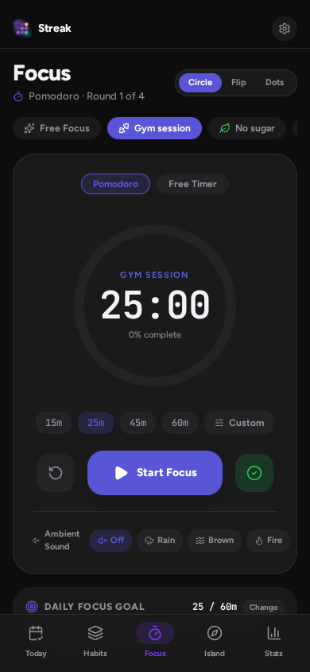
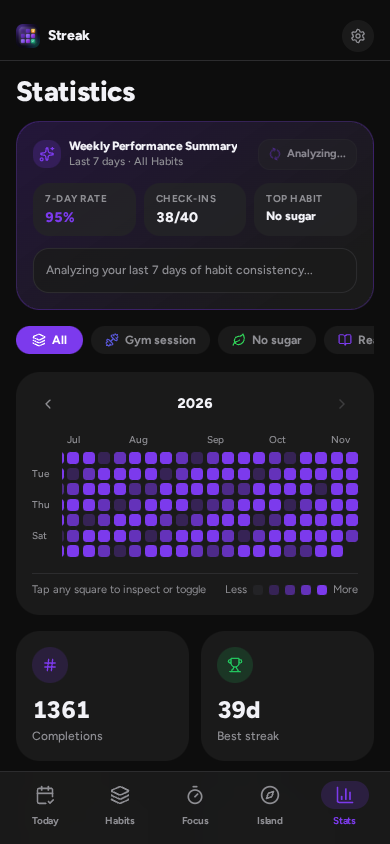

<div align="center">
  

  # Cadence — Minimal Habit Tracker & Focus PWA

  **A local-first, privacy-focused iPhone Progressive Web App for building daily rituals, visualizing 52-week activity heatmaps, running deep-work Pomodoro sessions, and growing an isometric Voxel Island.**

  Built & Designed by **Vineeth**

  [](https://www.typescriptlang.org/)
  [](https://react.dev/)
  [](https://vitejs.dev/)
  [](https://tailwindcss.com/)
  [](#privacy--data-storage)
</div>

---

## 📱 App Mockups & Screens

<div align="center">
  <table>
    <tr>
      <td align="center">
        <br />
        <sub><b>1. Today Screen</b><br />Personal greeting, hourly quote, wavy progress ring & 5d/7d strips</sub>
      </td>
      <td align="center">
        <br />
        <sub><b>2. Habits & Heatmaps</b><br />52-week GitHub-style activity heatmaps & habit management</sub>
      </td>
      <td align="center">
        <br />
        <sub><b>3. Focus / Pomodoro Timer</b><br />Circle, Flip & Dots clocks, custom durations & ambient audio</sub>
      </td>
    </tr>
    <tr>
      <td align="center">
        <br />
        <sub><b>4. Voxel Island</b><br />Earn coins from habits & focus sessions to build 12 voxel landmarks</sub>
      </td>
      <td align="center">
        <br />
        <sub><b>5. Statistics & Trends</b><br />Weekly coaching summary, Recharts line charts & radial gauge</sub>
      </td>
      <td align="center">
        <br />
        <sub><b>6. Settings & Data Hub</b><br />3 UI modes, 5 backgrounds, 11 themes & CSV/JSON backup</sub>
      </td>
    </tr>
  </table>
</div>

---

## ✨ Key Features

### 1. Daily Ritual Tracking & Habit Types
- **Three Habit Types**:
  - **Regular Check-in (`normal`)**: Single-tap daily completion with tactile haptic feedback.
  - **Quantitative Target (`amount`)**: Track measurable daily goals (e.g., `8 glasses`, `20 pages`, `3 L`) with quick `+` / `-` steppers and intensity-shaded heatmap cells.
  - **Quit / Avoid Bad Habit (`avoid`)**: Track clean days and abstinence streaks.
- **Flexible Scheduling**: Every day, specific weekdays (e.g., Mon–Fri without breaking weekend streaks), `N` times per week, `N` times per month, or every `N` days.
- **Habit Strength Score (`0–100%`)**: Exponentially weighted momentum indicator inspired by Loop Habit Tracker that grows with consistency and decays gently on a missed day instead of resetting all your progress to `0`.

### 2. Deep Personalization & Appearance Engine
- **3 UI Design Modes**:
  - **Minimal**: Ultra-compact rows with a 5-day quick-toggle strip.
  - **Classic**: Balanced cards with Habit Strength bars and a 7-day interactive pill strip.
  - **Express**: Large hero cards with custom **Habit Cover Photos**.
- **2 Today Card Layouts**: Switch instantly between **Compact List** and **2-Column Grid** directly from the Today header.
- **5 App Background Styles**: `Solid`, `Subtle Gradient`, `Dot Matrix`, `True-Black OLED`, and `Custom Photo Backdrop`.
- **11 Curated Color Palettes**: Including *Cadence Brand (Violet)*, *Mykonos (Aegean Blue)*, *Emerald Forest*, *Sunset Coral*, *Cyber Amber*, *Rose Quartz*, and *Monochrome*.
- **Personal Greeting & Hourly Single-Line Motivational Quotes**: Customizable greeting (`Hi, Alex` or `Today`) paired with a single-line habit motivation quote that rotates automatically every hour (with a manual refresh button).

### 3. Focus / Pomodoro Timer & Web Audio Soundscapes
- **Pomodoro & Stopwatch Modes**: Choose quick presets (`15m`, `25m`, `45m`, `60m`) or set your own **Custom Focus (`1–240m`) & Break (`1–60m`)** duration.
- **3 Clock Faces**: Switch between **Circle Ring**, **Retro Flip Clock**, and **10×6 Dot Matrix**.
- **Built-in Ambient Sound Synthesizer**: Real-time Web Audio API procedural soundscapes (**Soft Rain**, **Brown Noise**, **Cozy Campfire**, **Forest Wind**) with zero external audio file dependencies.
- **7-Day Focus History & Linked Habits**: Link focus sessions directly to any habit and track daily focus goal minutes.

### 4. Voxel Island Gamification
- **Earn Coins Automatically**:
  - `+10 coins` per completed habit check-in
  - `+1 coin` per focus minute logged
  - `+25 coins` per Perfect Day (all scheduled habits completed)
  - `+30 to +200 bonus coins` for 7-day, 30-day, and 100-day streak milestones
- **Build & Customize Your Island**: Unlock 12 isometric voxel landmarks (Whitewashed Village, Aegean Lighthouse, Windmill, Blue-Domed Chapel, Harbor Tavern, Cypress Grove, Fishing Boat, etc.), rotate the island camera (`0°`, `90°`, `180°`, `270°`), and switch between **Aegean Sun**, **Golden Sunset**, and **Starlit Night** lighting.

### 5. Rich Analytics & Recharts Visualizations
- **Weekly Performance Summary**: Analyzes your last 7 days of habit performance (7-day completion rate, completed vs. scheduled check-ins, active streaks, and top habit) and generates a concise, actionable coaching summary.
- **Dynamic Per-Habit Line Charts (Recharts)**: Interactive multi-habit and per-habit `<LineChart>` visualizations over **7D**, **30D**, and **90D** windows with toggleable metrics (**Rolling Rate %**, **Cumulative Completions**, and **Daily Logged Value**) plus a one-tap **Minimize / Expand** mode.
- **52-Week Activity Heatmap, 270° Consistency Gauge & Interactive Donut Chart**: Inspect completion distribution by month, day of week, time of day, and habit share.

### 6. Unified CSV / JSON Backup, Restore & App Showcase Mode
- **Unified "Import & Export Data" Hub**:
  - **Export to CSV**: Exports a comprehensive `.csv` file (`RecordType`, `Date`, `Year`, `MonthNumber`, `MonthName`, `DayOfMonth`, `DayOfWeek`, `TimestampISO`, `HabitName`, `Category`, `Status`, `LoggedValue`, `CurrentStreak`, `BestStreak`, `HabitStrengthPercent`, `TimerMode`, `TimerDurationMinutes`, `Details`) covering all habit summaries, daily check-in logs, and Pomodoro/Stopwatch timer logs.
  - **Import from CSV**: Full round-trip restore of Cadence CSV backups, plus automatic migration from **Loop Habit Tracker**, **HabitKit**, **HabitBull**, **Habitica**, or generic CSV files.
  - **Export / Import JSON**: Full application state snapshot including preferences and Voxel Island progress.
- **First-Time Interactive App Tour & Clean 0-Data Start**: First-time visitors get a 5-step onboarding tour and start with zero pre-filled habits or logs.
- **App Showcase Mode**: One-tap toggle at the bottom of Settings to preview 320 days of rich demonstration data without overwriting or losing your personal data.

---

## 🚀 How to Use

### Installing on iPhone (iOS Safari Home Screen PWA)
1. Open the deployed app URL in **Safari** on your iPhone.
2. Tap the **Share** button at the bottom of Safari.
3. Scroll down and tap **Add to Home Screen**.
4. Tap **Add** — the custom **Cadence** icon will appear on your iPhone Home Screen and launch in full-screen standalone mode with offline support.

### Daily Workflow
1. **Check In on Today**: Tap any checkmark on the **Today** screen (or tap a past day in the 5-day/7-day strip) to mark a habit complete. For quantitative habits (like *Drink water* or *Read before bed*), tap to increment or open the habit to adjust amounts.
2. **Switch Views & Density**: Use the top-right controls on the **Today** screen to cycle between `Minimal`, `Classic`, and `Express` card modes, toggle between **List** and **2-Column Grid**, or reorder habits.
3. **Run a Focus Session**: Open the **Focus** tab, pick a habit to link, select a preset (`15m`, `25m`, `45m`, `60m`) or tap **Custom** to set your own focus/break minutes, optionally enable ambient audio (*Rain*, *Fire*, *Brown Noise*), and press **Start**.
4. **Build Your Voxel Island**: Open the **Island** tab to spend coins earned from your habits and focus sessions on new voxel landmarks.
5. **Review Trends & Back Up Data**: Visit **Stats** to inspect your weekly performance summary and Recharts trend lines, and use **Settings → Backup & Restore → Import & Export Data (CSV / JSON)** to save backups to your iPhone Files / iCloud Drive.

---

## 🛠️ Tech Stack

- **Frontend**: React 19, TypeScript, Tailwind CSS 4
- **Charts & Motion**: Recharts (`LineChart`, `AreaChart`, `BarChart`), Custom SVG Heatmaps & Radial Gauges, Motion (`motion/react`), Lucide Icons
- **Storage & PWA**: Local-first `IndexedDB` (`idb` wrapper) + `localStorage` with `navigator.storage.persist()` protection, `vite-plugin-pwa` Service Worker & Web App Manifest
- **Audio & Haptics**: Web Audio API procedural noise synthesizer, Web Vibration API tactile haptics
- **Backend (Optional Coaching Endpoint)**: Node.js + Express (`server.ts`) serving `/api/weekly-summary`
- **Testing**: Node.js built-in test runner (`node:test` + `node:assert/strict`) executed via `tsx`

---

## 💻 Local Development

### Prerequisites
- **Node.js** `>= 20.x`
- **npm** `>= 10.x`

### 1. Clone & Install
```bash
git clone https://github.com/YOUR_USERNAME/cadence-habit-tracker.git
cd cadence-habit-tracker
npm install
```

### 2. Configure Environment (Optional)
If you want to enable the `/api/weekly-summary` coaching endpoint locally, create a `.env` file in the project root:
```env
GEMINI_API_KEY=your_api_key_here
```
*(The app works 100% offline without an API key and automatically uses its built-in local weekly coaching summary when no key is present.)*

### 3. Start the Development Server
```bash
npm run dev
```
Open `http://localhost:3000` in your browser.

### 4. Run Unit Tests & Type Check
```bash
npx tsx --test src/utils/habitLogic.test.ts
npm run lint
npm run build
```

---

## 🔒 Privacy & Data Storage

All habit definitions, daily check-in records, focus timer logs, and Voxel Island states are stored **locally on your device** using browser `IndexedDB` and `localStorage`:
- Sharing the deployed app link with friends gives each person a clean, independent app on their own phone—your personal data is never shared across devices.
- Before clearing browser website data or switching phones, use **Settings → Import & Export Data (CSV / JSON)** to download a backup file and restore it anytime.

---

## 👤 Author

**Vineeth**
- Designed and engineered with a focus on tactile mobile UX, local-first privacy, and long-term habit consistency.
