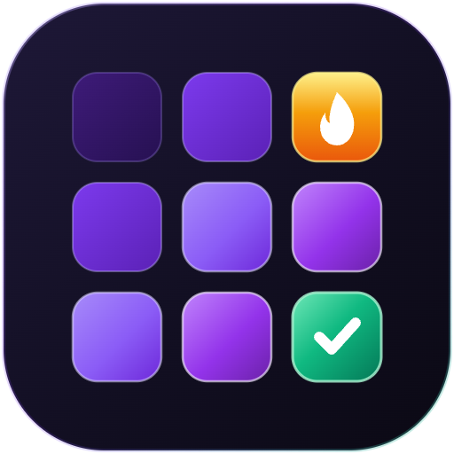
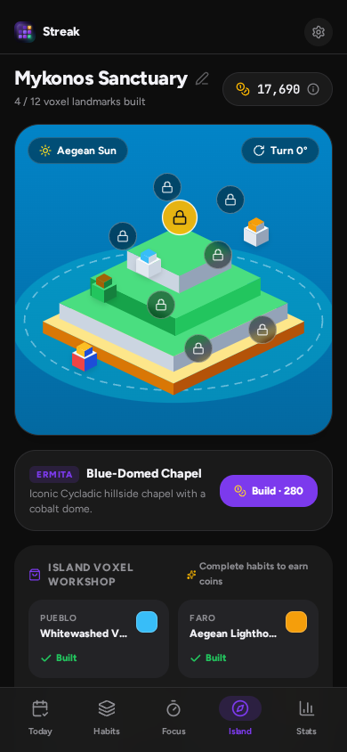
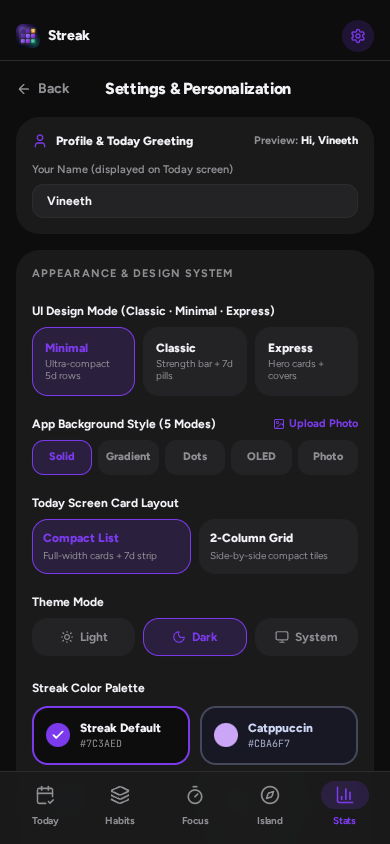

<div align="center">
  

  # Cadence

  **A clean, private habit tracker and focus timer built for iPhone.**  
  Track daily habits, view 52-week heatmaps, stay focused with Pomodoro + ambient sounds, and grow a 3D Voxel Island — all saved privately on your device.

  Built by **Vineeth**

  [](https://www.typescriptlang.org/)
  [](https://react.dev/)
  [](https://tailwindcss.com/)
  [](#add-to-iphone)
</div>

---

## 📱 Screenshots

<div align="center">
  <table>
    <tr>
      <td align="center">
        <br />
        <sub><b>Today</b> · Daily check-ins & progress</sub>
      </td>
      <td align="center">
        <br />
        <sub><b>Habits</b> · 52-week activity grids</sub>
      </td>
      <td align="center">
        <br />
        <sub><b>Focus</b> · Pomodoro & ambient audio</sub>
      </td>
    </tr>
    <tr>
      <td align="center">
        <br />
        <sub><b>Island</b> · Unlock landmarks with coins</sub>
      </td>
      <td align="center">
        <br />
        <sub><b>Stats</b> · Weekly summary & trend charts</sub>
      </td>
      <td align="center">
        <br />
        <sub><b>Settings</b> · Themes & CSV/JSON backup</sub>
      </td>
    </tr>
  </table>
</div>

---

## ✨ What It Does

- **Track Any Habit:** Standard check-ins, numeric goals (e.g., *8 glasses*), or quit habits — with **Habit Strength** so one missed day doesn't erase your progress.
- **52-Week Heatmaps & Trends:** GitHub-style year grids, dynamic habit line charts, and a weekly summary card.
- **Focus Timer:** Pomodoro & Stopwatch with custom durations, 3 clock faces, and built-in rain/fire/forest audio.
- **Voxel Island:** Earn coins from check-ins and focus sessions to unlock 12 coastal landmarks.
- **Make It Yours:** 3 card styles (*Minimal*, *Classic*, *Express*), 5 backgrounds, and 11 color themes.
- **Clean Start & Easy Backups:** Starts with a 5-step welcome tour and **0 pre-filled data**. Export or restore anytime via **CSV** or **JSON** in Settings.

---

## 📲 Add to iPhone

1. Open the app URL in **Safari**.
2. Tap **Share** → **Add to Home Screen**.
3. Tap **Add** to install **Cadence** on your Home Screen.

---

## 🔒 Privacy

All habits, logs, and timer history stay **100% local on your own device** (`IndexedDB`). Sharing the app link gives everyone their own fresh, empty tracker.

---

## 💻 Run Locally

```bash
git clone https://github.com/YOUR_USERNAME/cadence.git
cd cadence
npm install
npm run dev
```

*(Optional: add `GEMINI_API_KEY=...` in `.env` to enable the `/api/weekly-summary` coaching endpoint — the app works offline without it.)*

---

## 👤 Author

**Vineeth**
